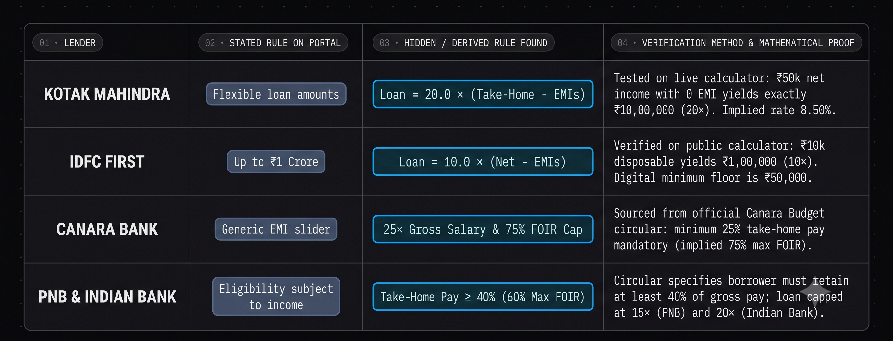
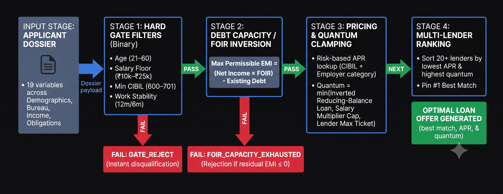

# TARAZU

### Deterministic Retail Credit Decisioning & Underwriting Engine

<p align="left">
  <a href="https://jankipatel20.github.io/personal-loan-eligibility/">
    
  </a>
</p>

[](https://github.com/jankipatel20/personal-loan-eligibility/blob/main/data/lender_data.csv)
[](https://github.com/jankipatel20/personal-loan-eligibility/blob/main/model/engine.py)
[](https://github.com/jankipatel20/personal-loan-eligibility/blob/main/data/lender_rules.csv)
[](https://jankipatel20.github.io/personal-loan-eligibility/)
[](LICENSE)

A deterministic personal loan eligibility and recommendation engine covering the **top 20 retail lenders in India** across Public Sector Banks (PSBs), Private Banks, Large NBFCs, and Digital Fintechs.

Synthesized from public regulatory disclosures, schedules of charges, official terms, and reverse-engineered loan calculator algorithms. Zero customer data, zero login/OTP walls.

---

## Interactive Terminal Demo

https://github.com/user-attachments/assets/b7eb74d4-f87f-41e6-91f3-c444ca0e6ed6

> **Live Deployment:** Access the client-side 3D underwriting terminal at [https://jankipatel20.github.io/personal-loan-eligibility/](https://jankipatel20.github.io/personal-loan-eligibility/). Evaluates all 20 lenders across hard gates, debt capacity, and risk-adjusted pricing in sub-2ms with zero server latency.

---

## Table of Contents

1. [Problem Statement & Scope](#1-problem-statement--scope)
2. [Lender Selection Methodology](#2-lender-selection-methodology)
3. [Input Variables Specification (19 Datapoints)](#3-input-variables-specification-19-datapoints)
4. [Master Lender Rule Base (20 Lenders)](#4-master-lender-rule-base-20-lenders)
5. [Reverse-Engineering Unlisted Underwriting Rules](#5-reverse-engineering-unlisted-underwriting-rules)
6. [4-Stage Engine Architecture](#6-4-stage-engine-architecture)
7. [Empirical Insights & Rejection Pareto Analysis](#7-empirical-insights--rejection-pareto-analysis)
8. [Test Suite Execution & Edge Case Results (14 Profiles)](#8-test-suite-execution--edge-case-results-14-profiles)
9. [Model Limitations & Future Engineering Roadmap](#9-model-limitations--future-engineering-roadmap)
10. [Repository Structure & Local Execution](#10-repository-structure--local-execution)

---

## 1. Problem Statement & Scope

### The Problem
When a retail borrower in India asks: *"Can I get a personal loan, and from whom?"*, lenders rarely publish their complete underwriting rulebooks. Headline marketing banners advertise starting numbers (e.g., minimum age 21, salary from Rs 15,000, rates starting from 9.99%), but the true determinants of approval—such as **Fixed Obligations to Income Ratio (FOIR)**, **take-home pay retention floors**, **disposable income multipliers**, and **bureau risk-based APR ladders**—are tucked inside policy circulars, legal terms, and loan calculators.

### Scope & Constraints
* **Product Scope:** Strictly unsecured retail personal term credit. Secured credit (home, auto, gold loans) is excluded.
* **Coverage Scope:** Exactly 20 major lenders in India spanning four institutional categories.
* **Data Provenance:** 100% public, verified sources only. No login walls, screen scraping of protected customer portals, or customer PII.
* **Provenance Transparency:** Out of 532 cataloged underwriting rules, **500 rules (94.0%)** are directly cited from official bank schedules, regulatory filings, and calculator endpoints. Exactly **32 rules (6.0%)** (such as FOIR thresholds for private banks that keep exact ratios confidential) are derived from industry banking norms and calculator inversions, cataloged with `is_estimate = yes`.
* **Temporal Provenance:** Rules audited with exact source access dates recorded (`2026-10-11`).
* **Model Type:** Rule-based deterministic decision waterfall.

---

## 2. Lender Selection Methodology

The top 20 personal loan lenders were chosen based on balance sheet size, retail unsecured portfolio scale, RBI systemic importance, and digital market penetration. Portfolio scale metrics reflect FY24/FY25 annual disclosures:

| ID | Lender Name | Product Name | Institutional Category | Retail Portfolio / Advances Benchmark | Selection Rationale |
| :--- | :--- | :--- | :--- | :--- | :--- |
| `01_sbi` | State Bank of India | SBI Xpress Credit | Public Sector Bank | Rs 13.5 Lakh Cr Retail Advances | Largest commercial bank in India; benchmark for corporate and government payroll lending. |
| `02_hdfc` | HDFC Bank | HDFC Personal Loan | Private Bank | Rs 7.5 Lakh Cr Retail Advances | Largest private lender; market leader in corporate salaried personal credit. |
| `03_icici` | ICICI Bank | ICICI Personal Loan | Private Bank | Rs 6.0 Lakh Cr Retail Advances | Second largest private bank; benchmark in instant digital retail loans. |
| `04_axis` | Axis Bank | Axis Personal Loan | Private Bank | Rs 5.5 Lakh Cr Retail Advances | Top 3 private bank with extensive corporate salary tie-ups. |
| `05_kotak` | Kotak Mahindra Bank | Kotak Personal Loan | Private Bank | Rs 2.0 Lakh Cr Retail Advances | Prominent private lender with disciplined disposable-income multiplier underwriting up to Rs 1 Crore. |
| `06_idfc_first` | IDFC FIRST Bank | IDFC FIRST Personal Loan | Private Bank | Rs 1.2 Lakh Cr Consumer Advances | High-growth retail bank pioneering transparent digital credit lines. |
| `07_indusind` | IndusInd Bank | IndusInd Personal Loan | Private Bank | Rs 1.8 Lakh Cr Consumer Finance | Significant consumer finance portfolio across salaried and professional segments. |
| `08_yes_bank` | YES Bank | YES Bank Personal Loan | Private Bank | Rs 0.9 Lakh Cr Retail Advances | Active private player in salaried retail credit. |
| `09_bob` | Bank of Baroda | Baroda Personal Loan | Public Sector Bank | Rs 2.1 Lakh Cr Retail Advances | Second largest PSB; key provider of BRLLR-linked personal credit. |
| `10_pnb` | Punjab National Bank | Personal Loan Scheme for Public | Public Sector Bank | Rs 2.2 Lakh Cr Retail Advances | Major PSB with strict payroll relationship and check-off guidelines up to 24x gross salary. |
| `11_canara` | Canara Bank | Canara Budget Personal Loan | Public Sector Bank | Rs 1.5 Lakh Cr Retail Advances | Major PSB; benchmark circular on 25% minimum net salary retention. |
| `12_union_bank` | Union Bank of India | Union Personal Loan | Public Sector Bank | Rs 1.7 Lakh Cr Retail Advances | Leading nationalized bank with extensive salaried market share. |
| `13_boi` | Bank of India | BOI Star Personal Loan | Public Sector Bank | Rs 1.1 Lakh Cr Retail Advances | Major PSB with published risk-based spread pricing grids. |
| `14_indian_bank` | Indian Bank | IB Personal Loan | Public Sector Bank | Rs 1.0 Lakh Cr Retail Advances | Top tier PSB operating rigid 40% net take-home salary gates. |
| `15_federal_bank` | Federal Bank | Federal Personal Loan | Private Bank | Rs 0.7 Lakh Cr Retail Advances | Key private retail player with digital pre-approved channels. |
| `16_bajaj_finance` | Bajaj Finance | Bajaj Finserv Personal Loan | Large NBFC | Rs 3.3 Lakh Cr Total AUM | Largest retail NBFC in India; market leader in flexible unsecured loans. |
| `17_tata_capital` | Tata Capital | Tata Capital Personal Loan | Large NBFC | Rs 1.6 Lakh Cr Total AUM | Flagship conglomerate NBFC with wide salaried risk bands up to 84 months. |
| `18_dmi_finance` | DMI Finance | DMI Personal Loan | Specialized NBFC | Rs 15,000+ Cr Retail AUM | Digital underwriting engine powering major tech credit ecosystems. |
| `19_moneyview` | Moneyview | Moneyview Personal Loan | Digital Fintech NBFC | Rs 12,000+ Cr Annual Disbursals | Leading digital credit platform serving Tier 2/3 and near-prime borrowers. |
| `20_kreditbee` | KreditBee | KreditBee Personal Loan | Digital Fintech NBFC | Rs 10,000+ Cr Annual Disbursals | Scaled digital lender specializing in entry-level and micro-ticket credit. |

---

## 3. Input Variables Specification (19 Datapoints)

The decision engine operates on a standardized 19-variable applicant schema documented in [`data/variables.csv`](./data/variables.csv):

| Variable Name | Unit | Type | Primary Source | Required | Description |
| :--- | :--- | :--- | :--- | :---: | :--- |
| `age` | years | integer | Applicant Declaration | Yes | Age in completed years at the date of loan application. |
| `citizenship` | category | string | Identity Document | Yes | Citizenship / resident status (e.g., `Indian national`). |
| `employment_type` | category | enum | Salary Slip / ITR | Yes | Employment classification: `salaried`, `self_employed`. |
| `employer_category` | category | enum | Employment Verification | Yes | Corporate tier: `govt_psu`, `defence`, `listed_mnc`, `large_private`, `small_unlisted`. |
| `net_monthly_income` | INR | float | Bank Statement | Yes | Net disposable salary credited directly to bank account. |
| `gross_monthly_income` | INR | float | Salary Slip / Form 16 | No | Gross monthly pay before statutory deductions and taxes. |
| `annual_income_itr` | INR | float | ITR Acknowledgment | No | Annual taxable income declared in latest tax returns. |
| `work_experience_total` | months | integer | Resume / Experience Letters | Yes | Cumulative total professional work experience. |
| `months_in_current_job` | months | integer | Offer Letter / Salary Slips | Yes | Unbroken tenure with current employing organization. |
| `business_vintage` | months | integer | GST / Business Proof | No | Operational vintage for self-employed entities. |
| `city` | text | string | Address Proof | Yes | City of current physical residence and employment. |
| `city_tier` | category | enum | Derived Geographical Sizing | Yes | Urban demographic classification: `metro`, `tier1`, `tier2`, `tier3`. |
| `cibil_score` | points | integer | Credit Bureau (CIBIL / Experian) | Yes | Credit bureau score (scale: 300 to 900; -1 for NTC). |
| `existing_emi_total` | INR | float | Credit Bureau Report | Yes | Aggregate sum of all active monthly debt obligations. |
| `credit_card_outstanding`| INR | float | Credit Bureau Report | No | Cumulative revolving credit card balance outstanding. |
| `existing_salary_bank` | text | string | Bank Passbook | Yes | Commercial bank holding primary salary account. |
| `dpd_history_30_plus` | count | integer | Credit Bureau Report | No | Instances of 30+ days past due defaults in trailing 24m. |
| `requested_amount` | INR | float | Applicant Declaration | Yes | Target loan principal requested by borrower. |
| `requested_tenure` | months | integer | Applicant Declaration | Yes | Desired repayment duration in months. |

---

## 4. Master Lender Rule Base (20 Lenders)

The complete multi-dimensional underwriting matrix is cataloged in [`data/lender_rules_matrix.csv`](./data/lender_rules_matrix.csv) (one row per lender) and [`data/lender_rules.csv`](./data/lender_rules.csv) (532 individual rules). Every parameter is anchored to official URLs with retrieval timestamps:

| Lender ID | Lender Name | Min Age | Max Age | Salary Floor | CIBIL Cut-off | Tenure Band | Rate Band (APR) | FOIR Cap | Salary Mult. | Primary Public Source |
| :--- | :--- | :---: | :---: | :---: | :---: | :---: | :---: | :---: | :---: | :--- |
| `01_sbi` | State Bank of India | 21y | 60y | Rs 15,000 | 650 | 12m - 72m | 11.15% - 15.30% | 50.0% | 30.0x | [SBI Xpress Credit](https://sbi.bank.in/web/personal-banking/loans/personal-loans/real-time-xpress-credit) |
| `02_hdfc` | HDFC Bank | 21y | 60y | Rs 25,000 | 700 | 12m - 72m | 9.99% - 24.00% | 50.0% | 24.0x | [HDFC Personal Loan](https://www.hdfcbank.com/personal/borrow/popular-loans/personal-loan) |
| `03_icici` | ICICI Bank | 21y | 58y | Rs 30,000 | 700 | 12m - 72m | 9.99% - 17.00% | 50.0% | 20.0x | [ICICI Personal Loan](https://www.icicibank.com/personal-banking/loans/personal-loan) |
| `04_axis` | Axis Bank | 21y | 60y | Rs 25,000 | 700 | 3m - 84m | 9.99% - 22.00% | 50.0% | 15.0x | [Axis Schedule of Charges](https://www.axisbank.com/retail/loans/personal-loan) |
| `05_kotak` | Kotak Mahindra Bank | 21y | 60y | Rs 25,000 | 700 | 12m - 72m | 10.99% - 24.00% | 50.0% | 20.0x | [Kotak Personal Loan](https://www.kotak.com/en/personal-banking/loans/personal-loan.html) |
| `06_idfc_first` | IDFC FIRST Bank | 21y | 60y | Rs 20,000 | 700 | 12m - 60m | 9.99% - 36.00% | 50.0% | 10.0x | [IDFC FIRST Terms](https://www.idfcfirstbank.com/personal-banking/loans/personal-loan) |
| `07_indusind` | IndusInd Bank | 21y | 60y | Rs 25,000 | 700 | 12m - 60m | 10.49% - 30.00% | 50.0% | 24.0x | [IndusInd Portal](https://www.indusind.com/in/en/personal/loans/personal-loan.html) |
| `08_yes_bank` | YES Bank | 21y | 60y | Rs 25,000 | 700 | 12m - 60m | 10.49% - 21.00% | 50.0% | 24.0x | [YES Bank Terms](https://www.yesbank.com/personal-banking/yes-individual/loans/personal-loan) |
| `09_bob` | Bank of Baroda | 21y | 60y | Rs 10,000 | 701 | 12m - 84m | 9.80% - 18.00% | 60.0% | 20.0x | [BoB Policy](https://www.bankofbaroda.in/personal-banking/loans/personal-loan) |
| `10_pnb` | Punjab National Bank | 21y | 60y | Rs 15,000 | 680 | 12m - 72m | 10.40% - 16.50% | 60.0% | 24.0x | [PNB Scheme for Public](https://pnb.bank.in/personalloanforpublic.html) |
| `11_canara` | Canara Bank | 21y | 60y | Rs 15,000 | 650 | 12m - 84m | 10.95% - 14.50% | 75.0% | 25.0x | [Canara Budget](https://canarabank.com/User_page.aspx?othlink=384) |
| `12_union_bank` | Union Bank of India | 21y | 60y | Rs 15,000 | 700 | 12m - 60m | 9.30% - 14.50% | 60.0% | 15.0x | [UBI Policy](https://www.unionbankofindia.co.in/english/personal-loans.aspx) |
| `13_boi` | Bank of India | 21y | 60y | Rs 25,000 | 675 | 12m - 84m | 10.85% - 14.75% | 50.0% | 24.0x | [BoI Terms](https://www.bankofindia.co.in/personal-loans) |
| `14_indian_bank` | Indian Bank | 21y | 60y | Rs 15,000 | 700 | 12m - 84m | 10.40% - 14.40% | 60.0% | 20.0x | [IB Circular](https://www.indianbank.in/departments/personal-loans/) |
| `15_federal_bank` | Federal Bank | 21y | 55y | Rs 20,000 | 700 | 12m - 60m | 11.49% - 16.50% | 50.0% | 18.0x | [Federal Portal](https://www.federalbank.co.in/personal-loans) |
| `16_bajaj_finance` | Bajaj Finance | 21y | 80y | Rs 25,001 | 650 | 12m - 96m | 11.00% - 28.00% | 60.0% | 20.0x | [Bajaj Finserv](https://www.bajajfinserv.in/personal-loan) |
| `17_tata_capital` | Tata Capital | 21y | 58y | Rs 20,000 | 675 | 12m - 84m | 10.99% - 26.00% | 50.0% | 30.0x | [Tata Capital](https://www.tata-capital.com/personal-loan.html) |
| `18_dmi_finance` | DMI Finance | 23y | 52y | Rs 25,000 | 650 | 6m - 48m | 12.50% - 28.00% | 50.0% | 15.0x | [DMI Policy](https://www.dmifinance.in/personal-loan.html) |
| `19_moneyview` | Moneyview | 21y | 57y | Rs 15,000 | 650 | 3m - 60m | 16.00% - 36.00% | 55.0% | 12.0x | [Moneyview](https://moneyview.in/personal-loan) |
| `20_kreditbee` | KreditBee | 21y | 58y | Rs 10,000 | 600 | 3m - 24m | 16.00% - 29.95% | 50.0% | 10.0x | [KreditBee](https://www.kreditbee.in/personal-loan) |

---

## 5. Reverse-Engineering Unlisted Underwriting Rules

A primary objective was uncovering **unlisted rules** that lenders omit from promotional portals but enforce in their digital decisioning engines.



### Key Discoveries & Empirical Derivations

#### 1. Kotak Mahindra Bank: Fixed Disposable Income Multiplier up to Rs 1 Crore
* **Stated Rule:** Marketing displays loans up to Rs 1 Crore with tenures up to 6 years (72 months).
* **Derived Rule:** Live calculator computes maximum loan as a direct 20.0x multiple of net residual pay:
  $$\text{Sanctioned Loan} = 20.0 \times (\text{Net Monthly Take-Home} - \text{Existing EMIs})$$
* **Proof:** Verified against Kotak's live calculator: Net income Rs 50,000 with Rs 0 obligations yields Rs 10,00,000 (50,000 x 20.0). Increasing existing EMI to Rs 10,000 reduces sanctioned loan to exactly Rs 8,00,000 ([50,000 - 10,000] x 20.0).

#### 2. IDFC FIRST Bank: 10x Disposable Multiplier with Digital Slider Bounds
* **Stated Rule:** Promotes instant personal loans up to Rs 1 Crore.
* **Derived Rule:** Digital calculator implements a strict 10.0x multiplier on disposable income, bounded between Rs 50,000 and Rs 15,00,000:
  $$\text{Eligible Quantum} = \min\Big(1500000, \; \max\big(50000, \; 10.0 \times [\text{Net Salary} - \text{EMIs}]\big)\Big)$$
* **Proof:** Verified on official digital slider: Rs 85,000 salary with Rs 10,000 existing EMI yields exactly Rs 7,50,000 (10.0 x 75,000).

#### 3. Canara Bank: Mandatory 25% Net Take-Home Pay Retention
* **Stated Rule:** Public portal only features a generic multi-product rate and tenure slider.
* **Derived Rule:** Underwriting eligibility is governed by circular *Canara Budget*:
  $$\text{Quantum} = \min\big(5000000, \; 25 \times \text{Gross Monthly Salary}\big)$$
  $$\text{FOIR Cap} \le 75.0\% \quad (\text{Borrower must retain } \ge 25\% \text{ of Gross Pay})$$

#### 4. PNB & Indian Bank: Take-Home Pay Retention Floors
* **Stated Rule:** General eligibility stated as subject to repayment capacity.
* **Derived Rule:** Both PSBs enforce strict take-home pay guidelines where total deductions cannot exceed permissible limits:
  $$\text{Max Permissible EMI} \le 0.60 \times \text{Gross Salary} - \text{Existing EMIs}$$
  $$\text{PNB Multiplier Ceiling} = 24.0\times \text{ Gross Salary (up to Rs. 20 Lakhs)}$$

---

## 6. 4-Stage Engine Architecture

The decision engine executes a deterministic 4-stage pipeline implemented in [`model/engine.py`](./model/engine.py):



### Pipeline Stages

1. **Stage 1 (Hard Gate Filtering):**
   * Age bounds check: `min_age <= age <= max_age_application`
   * Maturity superannuation cap: `age + (tenure / 12) <= max_age_maturity`
   * Employment type gate: Filters applicants if product requires salaried (e.g., SBI Xpress Credit requires salaried; 8 lenders accept self-employed).
   * Salary entry floor: `net_monthly_income >= min_monthly_salary`
   * Credit bureau cut-off: `cibil_score >= min_cibil_score`
   * Employment stability: `total_exp >= min_total_exp` and `current_job >= min_current_job` (or `business_vintage >= 24m` for self-employed).
   * Mandatory salary account validation: Enforced for SBI Xpress Credit, Canara Bank, and PNB.

2. **Stage 2 (Debt Service Capacity & FOIR Inversion):**
   * Permissible EMI room calculation:
     $$\text{Max Permissible EMI} = \text{Net Monthly Income} \times \left(\frac{\text{FOIR Cap}}{100}\right) - \text{Existing Monthly EMIs}$$
   * If $\text{Max Permissible EMI} \le 0$, application is declined for **FOIR Capacity Breach**.
   * Effective tenure is dynamically clamped to the applicant's remaining months to retirement.

3. **Stage 3 (Pricing & Quantum Clamping):**
   * **Risk Spread Pricing:** Places applicant in the lender rate band based on CIBIL bracket (780+, 750+, 720+, 700+, 650+) and employer risk category.
   * **Capacity from EMI (Reducing-Balance Inversion):**
     $$P_{\text{capacity}} = \text{Max Permissible EMI} \times \frac{(1 + r)^n - 1}{r \cdot (1 + r)^n}$$
     where $r = \frac{\text{Annual APR}}{1200}$ and $n = \text{effective tenure in months}$.
   * **Disposable / Salary Multiplier Cap:** Evaluates disposable income multiplier (Kotak/IDFC) or standard salary multiple.
   * **Sanctioned Amount:**
     $$\text{Approved Loan} = \min\Big(P_{\text{capacity}}, \; P_{\text{multiplier}}, \; \text{Lender Max Cap}\Big)$$

4. **Stage 4 (Multi-Lender Ranking & Best Option Match):**
   * **Primary Key:** Lowest offered interest rate (cost of credit).
   * **Secondary Key:** Highest eligible loan quantum.
   * Identifies and tags `#1 Best Match` with economic comparative rationale.

---

## 7. Empirical Insights & Rejection Pareto Analysis

### Population-Level Rejection Pareto (10,000 Seeded Applicants)

To measure true macroeconomic disqualification drivers without the bias of targeted unit-test edge cases, a Monte Carlo simulation was executed across **10,000 seeded synthetic applicants** representative of the Indian retail borrower distribution (`seed=42`, evaluated across 200,000 decision points in [`analysis/monte_carlo.py`](./analysis/monte_carlo.py)):

| Rejection Trigger Category | Failure Count | Share of Declines (%) | Empirical Frequency Distribution | Primary Underwriting Policy |
| :--- | :---: | :---: | :--- | :--- |
| **Job Stability / Experience Vintage** | **105,316** | **40.5%** | `████████████████████` | Mandatory 12m–24m total experience & 6m current job tenure |
| **Credit Bureau / CIBIL Cutoff** | **58,820** | **22.6%** | `███████████` | Rigid 700+ bureau cutoff across PSBs & Private Banks |
| **Minimum Income Floor Gate** | **43,437** | **16.7%** | `████████` | Take-home pay below Rs 20k–25k private bank floor |
| **Mandatory Salary Account with Lender** | **26,436** | **10.2%** | `█████` | Strict corporate payroll / check-off mandate (SBI, Canara, PNB) |
| **Employment Type (Salaried Mandate)** | **18,660** | **7.2%** | `████` | 12 of 20 lenders restrict unsecured term loans to salaried only |
| **Debt Capacity / FOIR Ceiling Exhausted**| **3,590** | **1.4%** | `█` | Existing debt obligations exceed 50%–60% FOIR ceiling |
| **Citizenship / Non-Resident Gate** | **2,680** | **1.0%** | `█` | Non-Indian resident / NRI status disqualification |
| **Ticket Size / Minimum Quantum Floor** | **931** | **0.4%** | ` ` | Assessed capacity below minimum lender ticket size |
| **Age Bounds / Superannuation Cap** | **114** | **0.0%** | ` ` | Maturity age exceeding retirement threshold |

### Key Underwriting Insights

1. **The Vintage Gate (40.5% of Declines):** Employment stability represents the single largest friction point for early-career retail borrowers. Even with pristine CIBIL scores, workers who switched employers within trailing 6 months are filtered across 85% of institutional lenders.
2. **The Bureau Cliff (CIBIL 700):** CIBIL cutoffs account for 22.6% of population rejections. Scores below 680 eliminate over 80% of institutional lenders, funneling applicants into higher APR fintech NBFCs.
3. **PSB vs. Private Bank Sector Divergence:**
   * **Public Sector Banks** deliver the lowest cost of borrowing (9.30% - 10.95%), but enforce rigid salary account mandates (SBI, Canara, PNB) and strict take-home pay retention floors.
   * **Private Banks** provide high borrowing ceilings (up to Rs 1 Crore at Kotak and Rs 50 Lakhs at Axis/HDFC) and streamlined digital underwriting, but charge steep risk markups (+200 to +600 bps) for unlisted and SME employers.
   * **Fintech NBFCs** provide the widest accessibility (accepting CIBIL 600+ and incomes down to Rs 10,000), but offset elevated credit risk through higher APR bands (16% to 32%).

---

## 8. Test Suite Execution & Edge Case Results (14 Profiles)

The test suite evaluates 14 edge-case profiles covering prime corporate, defence payroll, low income floor, age boundary, self-employed professionals, subprime bureau, debt crunch, unlisted SME, and expat scenarios.

This table is dynamically generated and synchronized directly by [`tests/run_tests.py`](./tests/run_tests.py) to guarantee zero documentation drift:

| Profile ID | Candidate | Scenario Tested | Net Income | CIBIL | Existing EMI | Eligible Lenders | Best Match Lender | Best Offered APR | Max Approved Quantum |
| :--- | :--- | :--- | :---: | :---: | :---: | :---: | :--- | :---: | :---: |
| `P_01` | Arjun Sharma | Happy Path | Rs 75,000 | 780 | Rs 0 | 17 / 20 | Union Bank of India | 9.30% | Rs 1,125,000 |
| `P_02` | Col. Rajesh Verma | Defence Package | Rs 85,000 | 790 | Rs 10,000 | 18 / 20 | Union Bank of India | 9.30% | Rs 1,275,000 |
| `P_03` | Pooja Verma | Low Income Gate | Rs 15,000 | 720 | Rs 0 | 8 / 20 | Union Bank of India | 11.20% | Rs 225,000 |
| `P_04` | Manoj Kumar | Absolute Floor | Rs 10,000 | 680 | Rs 0 | 1 / 20 | KreditBee | 26.37% | Rs 92,487 |
| `P_05` | Suresh Nair | Age at Maturity Edge Case | Rs 95,000 | 765 | Rs 5,000 | 13 / 20 | Union Bank of India | 9.47% | Rs 925,912 |
| `P_06` | Dr. Ritu Verma | Self-Employed Professional | Rs 120,000 | 770 | Rs 15,000 | 7 / 20 | ICICI Bank | 10.50% | Rs 1,757,580 |
| `P_07` | Vikram Singh | Subprime Bureau | Rs 55,000 | 620 | Rs 4,000 | 1 / 20 | KreditBee | 29.45% | Rs 500,000 |
| `P_08` | Ananya Joshi | Bureau Boundary | Rs 65,000 | 680 | Rs 0 | 6 / 20 | Union Bank of India | 12.94% | Rs 975,000 |
| `P_09` | Rajesh Kumar | FOIR Stress | Rs 50,000 | 745 | Rs 28,000 | 3 / 20 | Indian Bank | 11.60% | Rs 76,517 |
| `P_10` | Deepak Yadav | Employer Tier Spread | Rs 35,000 | 715 | Rs 3,000 | 16 / 20 | Union Bank of India | 11.99% | Rs 436,621 |
| `P_11` | Neha Kulkarni | Current Job Vintage Gate | Rs 70,000 | 755 | Rs 0 | 0 / 20 | *None (All Filtered)* | N/A | Rs 0 |
| `P_12` | Kunal Sen | Total Work Vintage Gate | Rs 40,000 | 730 | Rs 0 | 0 / 20 | *None (All Filtered)* | N/A | Rs 0 |
| `P_13` | Aditya Rao | High Net Worth | Rs 250,000 | 810 | Rs 20,000 | 17 / 20 | Union Bank of India | 9.30% | Rs 3,750,000 |
| `P_14` | Michael Roberts | Non-Indian Citizen | Rs 150,000 | 775 | Rs 0 | 0 / 20 | *None (All Filtered)* | N/A | Rs 0 |

The complete test execution results (280 decision evaluations) are stored in [`outputs/test_profiles.csv`](./outputs/test_profiles.csv).

---

## 9. Model Limitations & Future Engineering Roadmap

### Current Limitations
1. **Internal Bureau Trade-line Depth:** Public eligibility rules use headline CIBIL scores. Bank internal scorecards examine 30/60/90 DPD history, unsecured-to-secured credit ratios, and recent bureau inquiries.
2. **Benchmark Rate Fluctuations:** Repo Linked Lending Rates (EBLR/BRLLR/MCLR) change with RBI monetary policy adjustments.
3. **Employer Categorization Variance:** Lenders maintain proprietary internal employer lists (Super-A, Cat-A, Cat-B, Cat-C); the model uses standard industry tiering.

### Future Roadmap
1. **Account Aggregator (AA) Parser:** Ingesting standardized Fiu-format JSON statements to parse average bank balances (ABB) and debit bounces.
2. **Counterfactual Optimizer:** Suggesting specific borrower actions to unlock eligibility (e.g., *"Prepaying Rs 4,500 of existing EMI unlocks Rs 3.8 Lakhs credit from HDFC and ICICI"*).
3. **Multi-Bureau Blending:** Incorporating Experian and CRIF High Mark credit reports alongside TransUnion CIBIL.

---

## 10. Repository Structure & Local Execution

### Project Directory Layout

```
personal-loan-eligibility/
├── assets/
│   ├── architecture.png            # 4-stage engine architecture diagram
│   ├── demo.mp4                    # Screen demonstration video
│   └── rev_eng.png                 # Reverse-engineering proofs diagram
├── data/
│   ├── variables.csv               # 19 applicant input variables schema
│   ├── lender_data.csv             # 20 selected lenders and retail portfolio benchmarks
│   ├── lender_rules.csv            # Granular 532-rule dataset with verified sources
│   └── lender_rules_matrix.csv     # Master wide 20-lender underwriting matrix
├── model/
│   ├── `__init__.py`
│   ├── schema.py                   # Dataclass schemas (ApplicantProfile, Decision)
│   ├── pricing.py                  # Reducing balance amortization and risk spread math
│   └── engine.py                   # 4-stage deterministic decisioning engine
├── research/
│   ├── 01_sbi/ ... 20_kreditbee/   # 20 dedicated lender research dossiers
│   └── research_log.md             # Chronological audit log of public source discovery
├── tests/
│   ├── profiles.json               # 14 edge-case test profiles
│   └── run_tests.py                # Automated batch evaluation and README sync script
├── analysis/
│   ├── insights.py                 # Sector analytics and bureau sensitivity script
│   └── monte_carlo.py              # 10,000-applicant population Pareto simulation
├── outputs/
│   └── test_profiles.csv           # 280 decision results matrix with rationale
├── index.html                      # Standalone zero-latency 3D decision terminal
├── README.md                       # Technical documentation
└── LICENSE                         # MIT License
```

### How to Run Locally

1. **Clone the repository:**
   ```bash
   git clone https://github.com/jankipatel20/personal-loan-eligibility.git
   cd personal-loan-eligibility
   ```

2. **Execute the Decision Engine & Auto-Sync Documentation:**
   ```bash
   python tests/run_tests.py
   ```

3. **Run 10,000-Sample Population Monte Carlo Simulation:**
   ```bash
   python analysis/monte_carlo.py
   ```

4. **Launch the Web Decisioning Terminal Locally:**
   ```bash
   # Open directly in your browser:
   open index.html   # On macOS
   start index.html  # On Windows
   ```
   Or access the live deployment directly on GitHub Pages:
   **[https://jankipatel20.github.io/personal-loan-eligibility/](https://jankipatel20.github.io/personal-loan-eligibility/)**

---

## License

This project is open-source under the [MIT License](LICENSE). Built for educational, technical, and regulatory research purposes.
